# StrmAction

> 面向 `.strm` 媒体库的「刮削 + 展示 + 播放分发」Web 应用。
> 不转码、不代理视频流、不碰网盘鉴权——把播放从 Jellyfin 里彻底剥离。

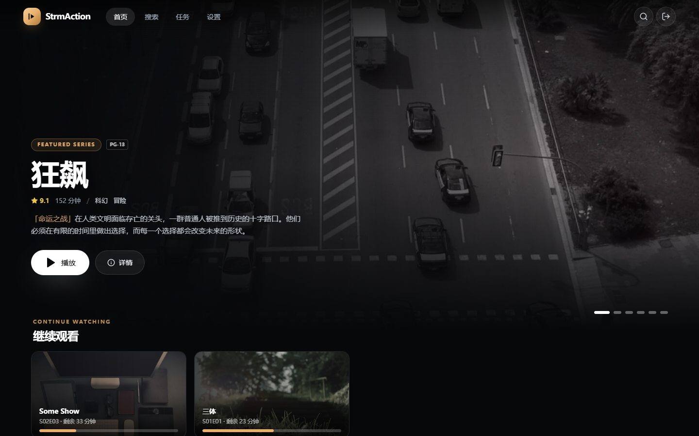

## 这是什么

SmartStrm 生成的 `.strm` 文件里只有一行网盘解析地址。StrmAction 扫描这些文件，用
**TMDB + TVDB** 自己刮削元数据，提供 VidHub / SenPlayer 级别的浏览界面；用户点播放时，
把该集 `.strm` 里的 URL 交给播放器：**StrmAction 桌面端内嵌 Qt 播放器（5 秒进度心跳）**、
**伴侣 App 内置 Media3**，Android 浏览器可跳转系统播放器，纯网页兜底复制链接。
（v1.3 起不再依赖 mpv，服务端也不会启动任何播放器进程。）

```
SmartStrm 生成 .strm（内容 = 网盘解析地址）
        │
        ▼
StrmAction 扫描目录 → 解析命名 → TMDB/TVDB 刮削 → 入库
        │
        ▼
用户浏览（伴侣 App / 手机浏览器 / 桌面 / TV）
        │  点击播放
        ▼
桌面端内嵌播放器 / 伴侣 App 内置 Media3 ──(302)──► Alist ──(302)──► 百度 CDN
        │
        └─ 全程不经过 StrmAction，服务端零中转、零带宽、零转码
```

**播放请求头（UA/Referer）由服务端按库下发**，桌面端与伴侣 App 的内置播放器都会带上；
服务端对视频数据**永不发起请求**，只读取 `.strm` 文本、下载海报与背景图。

## 功能

| 模块 | 已实现 |
|---|---|
| 媒体库 | 四种类型（电影 / 电视剧 / 家庭视频 / 课程）、多目录、启停、定时扫描 |
| 扫描 | 增量（mtime+size）、软删除（`missing`）、按内容 URL 归并改名/移动、忽略规则、符号链接越界防护 |
| 解析 | 目录模板优先 + 规则链 + guessit 兜底；中文、全角括号、季集、多版本、分段、显式 ID |
| 刮削 | TMDB + TVDB 双源、可配优先级、打分匹配、跨源补空、`{tmdb-603}` 直取、本地 `.nfo` 完全接管 |
| 元数据 | 17 项字段、季/集详情、剧照、演职员头像、预告片、合集、分级、别名 |
| 维护 | 单条刷新 / 全库刷新 / 每 30 天自动刷新、`meta_hash` 跳过无变更、字段锁定、手动匹配、解除匹配 |
| 图片 | 三档尺寸 WebP、URL 级去重、异步头像/剧照队列、主题色提取、`/img` 长缓存 |
| 播放 | 伴侣 App 内置 Media3（默认：自带请求头、续播、无缝连播、现代矢量控件、中心播放、双击快进退、长按倍速及设置、选集/倍速/全屏/锁定、**缓存上限与缓冲进度**）、桌面端原生硬件加速内嵌播放器（QVideoWidget + 内置轻量流媒体代理，零外部二进制依赖与路径配置，三层缓冲条/40% 抽屉/全套键盘控制/顶部半透明长按 2.0x 倍速）、浏览器 `intent://`、复制链接（v1.3 移除 mpv 依赖） |
| 进度 | 内置播放器 5 秒心跳、暂停/退后台补写、`play_token`（item 级 12h、Bearer）、90% 自动已看、防倒退、离线补发、支持从「继续观看」移除（保留进度与断点）、多用户隔离 |
| 用户与权限 | 多用户体系（管理员 + 普通用户）、细粒度媒体库访问授权、播放进度与已看记录多用户完全隔离、个人播放偏好（设置页「我的播放方式」）、用户管理与密码重置后台（`/users`） |
| 前端 | 手机优先布局、Hero 轮播（触摸横滑）、继续观看（支持快捷移除且保留媒体库进度）、分类横滑、详情、选集、搜索、用户管理、设置、任务、待修正列表、首次向导 |
| TV | 伴侣 App 手机/电视通用、`?tv=1` 10-foot 布局、方向键空间导航 + 滚屏兜底、48px 安全区、焦点光晕 |
| 运维 | 单容器 Docker、配置优先级 DB > yaml > 默认、导出/导入、任务日志、Provider 连通性测试 |

## 核心特性与架构设计

- **多用户与权限隔离体系（v0.9）**：
  - **角色与权限**：清晰划分为管理员（admin）与普通用户（user）；管理员拥有系统全权（库管理、任务调度、系统配置与用户管理），普通用户可浏览与播放被显式授权的媒体库，并可在「设置」中调整自己的播放方式、修改自己的登录密码、查看应用版本与关于信息；全局配置仍仅管理员可改。
  - **全局内容隔离**：首页 Hero 轮播、继续观看、最近添加、分类横滑、搜索与条目详情全局按用户媒体库授权范围严格过滤，彻底杜绝越权访问。
  - **播放进度与已看独立**：每个用户的播放进度、断点与已看状态完全独立，换设备换账号互不干扰。
  - **后台与个人管理**：内置 `/users` 用户管理控制台，管理员可直观增删改查用户、重置密码、勾选媒体库分配；支持各用户自主修改个人登录密码。
  - **设置分层**：普通用户打开「设置」只看到「我的播放方式」「安全」「关于」，可自选 `builtin（伴侣 App 内置）/ browser_intent（Android 外部播放器）/ copy（复制链接）/ auto` 与失败回退提示。设置页会显示「当前设备实际使用」并对不支持的播放方式给出降级提示。全局播放器默认、库管理、元数据源等仍仅管理员可改，`/api/export`、`/api/import` 同样要求管理员。
- **播放**：桌面端内嵌 Qt 播放器与伴侣 App 内置 Media3；5 秒进度心跳、`play_token` 回传、播完无缝连播；
  播放请求头按媒体库下发。v1.3 起服务端不再启动 mpv，`external_mpv` / `desktop_mpv` 模式已下线。
- **播放控件主流化与长按倍速**：全面重构伴侣 App 播放器 UI，换用现代主流矢量图标；新增屏幕中心
  悬浮大播放键、双击左/右快退快进手势与反馈、长按触感震动极速播放，并支持自定义长按倍速（1.5x~3.0x）。
- **40% 抽屉交互与主流界面**：选集、倍速与更多菜单采用右侧 40% 侧滑抽屉取代传统弹窗；返回键在全屏与非全屏模式下均直接退出播放。
- **「继续观看」管理**：同一播放列表（剧集/课程文件夹）只显示最后一次播放的那一集，不再一集一张卡；
  支持将整个播放列表从首页移除（保留媒体库与详情页里的已看集与进度条），再次播放自动重新激活。
- **APK 手机优先**：WebView 触摸滚动不再被父容器/桥接层干扰；修复 JS 桥在 JavaBridge 线程
  访问 `WebView` 导致点击播放报「Java exception」；画中画只在真正播放后触发；支持网页里的
  海报上传；设置页「伴侣 App」可直接重开服务器配置。
- **前端**：Hero 轮播支持手指横滑；TV 遥控方向键在没有可聚焦元素时整页滚动；详情页移动端
  背景高度收敛，首屏操作按钮更早出现。
- **模块化架构与可维护性重构**：
  - 后端刮削体系引入开放式的 `@register_provider` 插件注册中心，解耦核心调度与 Provider，支持第三方元数据源轻松扩展。
  - 数据模型层安全封装 `locked_fields` 等字段的读写，消除各层手动 JSON 序列化样板。
  - Web 前端 `SettingsPage` 拆解为 `Library` / `Scraper` / `Player` / `System` 独立领域组件。
  - Android 伴侣端播放器解耦 40% 右侧抽屉 (`PlayerDrawer`)、音轨字幕 (`PlayerTrackHelper`) 与倍速管理 (`PlayerSpeedHelper`)。
  - 修复后端图片处理误转 RGB 导致 Logo 出现黑框的问题，原生保留 WebP 8-bit Alpha 透明通道。
- **后端**：`config.example.yaml` 与 `player.*`（builtin / 心跳 / `play_token` /
  请求头）对齐。

截图：

| 详情 | 搜索 |
|---|---|
| 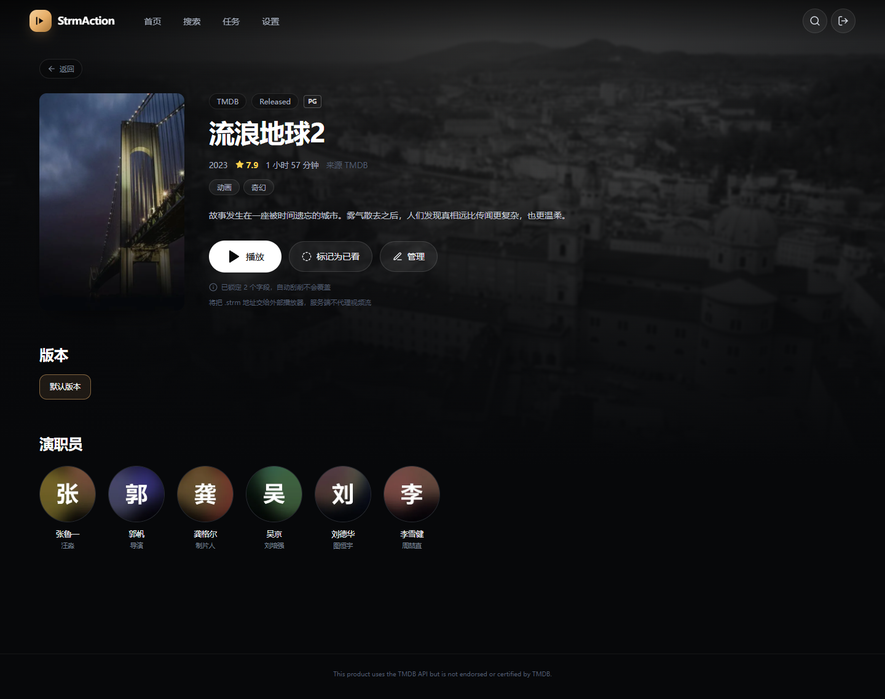 | 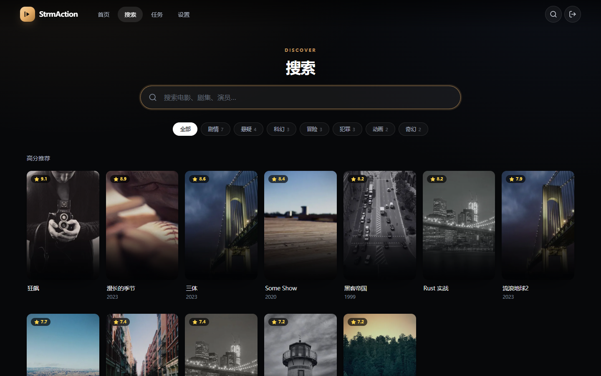 |

| 设置 | 任务 |
|---|---|
| 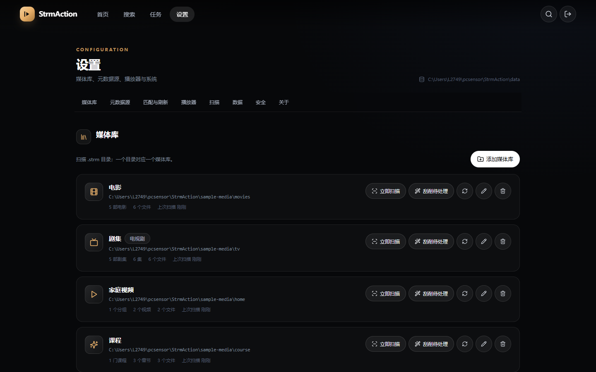 | 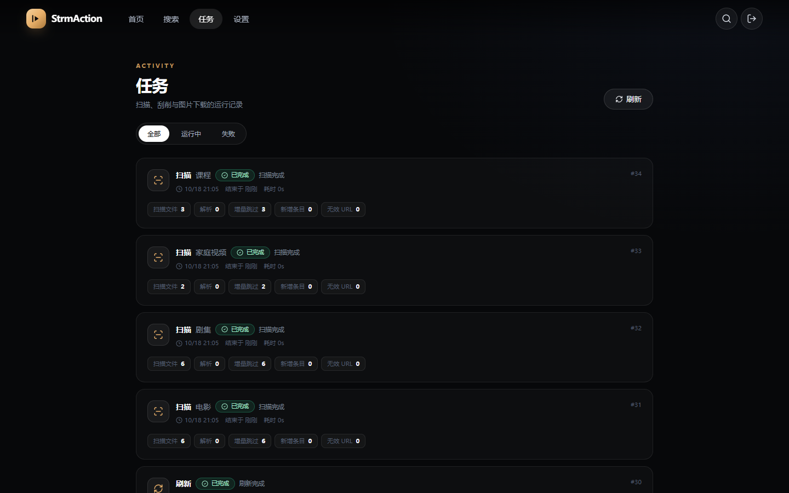 |

手机（伴侣 App / 移动浏览器）：

| 首页 | 详情 |
|---|---|
| 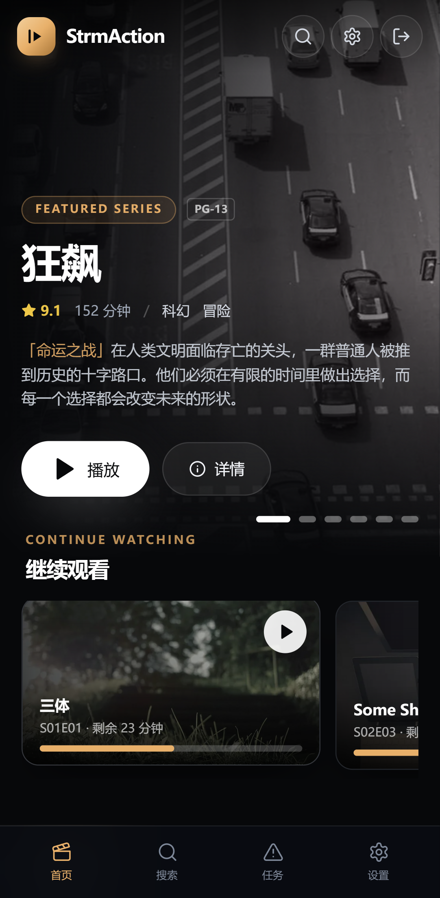 | 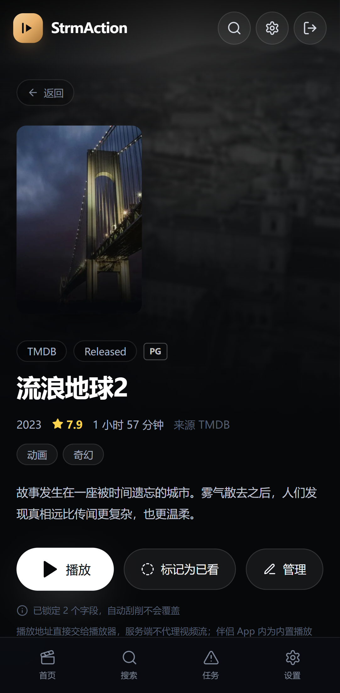 |

| 设置 |
|---|
| 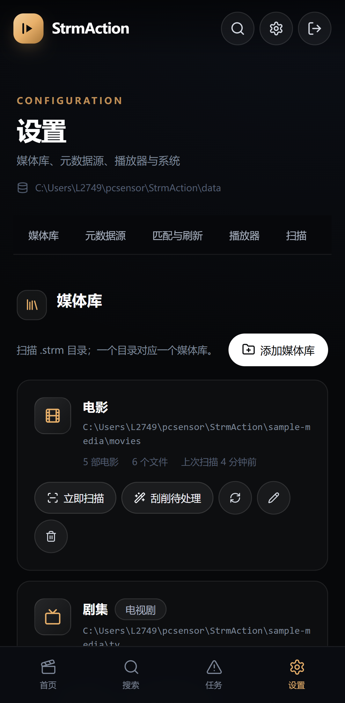 |

伴侣 App 实机（Android 14）：

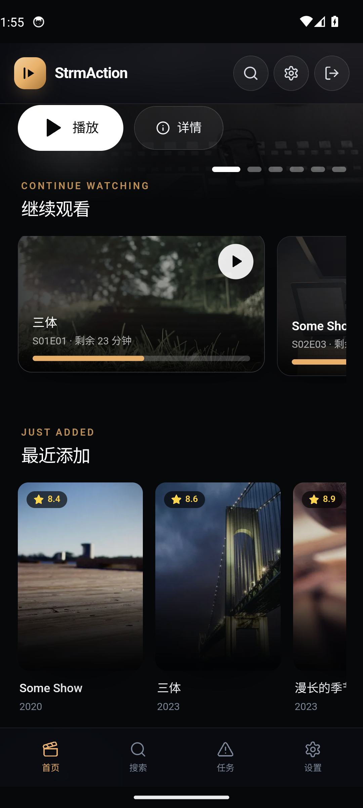

43 秒功能演示：[strmaction-demo.webm](docs/demo/strmaction-demo.webm)
（首页 → 详情 → 选集 → 搜索 → 任务 → 设置 → TV 布局。视频录制于内置播放器上线前，
播放流程以本文「播放」章节为准）。

## 快速开始（Docker Compose）

> **云服务器 / 公网 HTTPS 部署**：用 [`docker-compose.cloud.yml`](docker-compose.cloud.yml)
> + [`.env.cloud.example`](.env.cloud.example)，完整步骤（防火墙、域名、Caddy/Nginx、
> `.strm` 同步、备份、排错）见 **[docs/deploy-cloud.md](docs/deploy-cloud.md)**。
> 下面的 compose 更适合 NAS / 局域网。

```bash
git clone <repo> strmaction && cd strmaction

# 可选：准备 .env 覆盖卷与密钥
cat > .env <<'EOF'
STRMACTION_BASE_URL=http://192.168.1.10:8080
STRMACTION_MEDIA_PATH=/volume1/media/strm
STRMACTION_TMDB_KEY=
STRMACTION_TVDB_KEY=
EOF

docker compose up -d --build
```

打开 `http://<主机IP>:8080`，按向导完成：

1. 设置管理员密码（至少 8 位，不能纯数字）；
2. 填 TMDB / TVDB Key（可「稍后配置」，先走文件名兜底）；
3. 添加第一个识别目录（容器内路径，如 `/media/strm/movies`）并扫描。

| 初始化 · 密码 | 初始化 · 媒体库 |
|---|---|
| 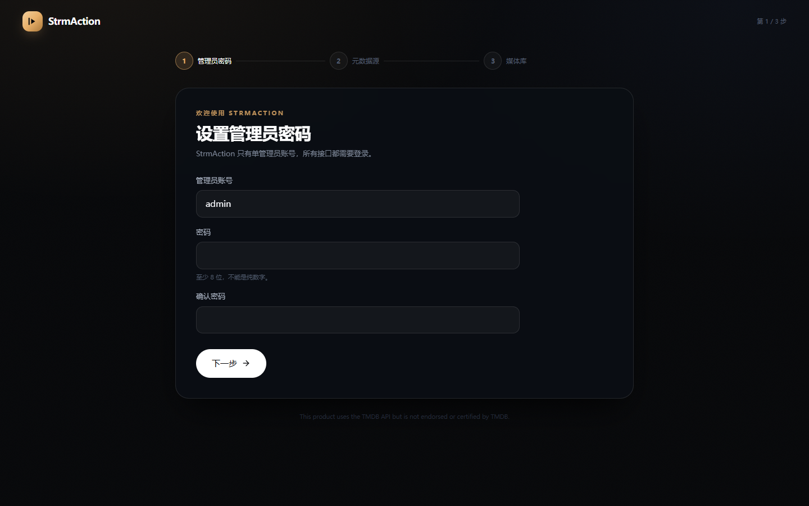 | 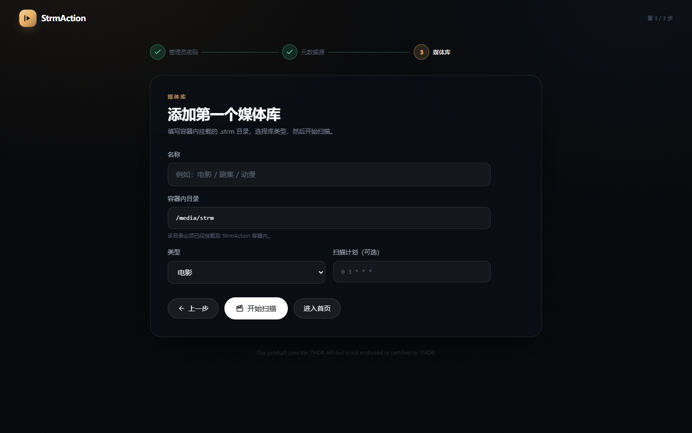 |

> 媒体目录以**只读**方式挂载。容器内路径必须与设置里填的路径一致。
> 数据（SQLite、图片、会话密钥）持久化在 `./data`。

### 手动 docker run

```bash
docker build -t strmaction:latest .

docker run -d --name strmaction --restart unless-stopped \
  -p 8080:8080 \
  -v "$PWD/data:/data" \
  -v "/volume1/media/strm:/media/strm:ro" \
  -e STRMACTION_BASE_URL=http://192.168.1.10:8080 \
  -e STRMACTION_TMDB_KEY=你的Key \
  strmaction:latest
```

### 本地开发

后端：

```bash
python -m venv .venv
# Windows: .venv\Scripts\activate    macOS/Linux: source .venv/bin/activate
pip install -r backend/requirements.txt

cp config.example.yaml config.yaml   # 按需修改 data_dir / base_url
export PYTHONPATH=$PWD/backend
uvicorn app.main:app --reload --port 8080 --app-dir backend
```

前端（另一个终端）：

```bash
cd frontend
npm install
npm run dev        # http://127.0.0.1:5173，已代理 /api 与 /img 到 8080
```

生产构建由 Docker 自动完成；手动构建：

```bash
cd frontend && npm run build
# 后端会自动发现 frontend/dist 并托管
```

## 配置

优先级：**设置页（数据库） > `config.yaml` > 内置默认值**。
`config.yaml` 只用于初始值与密钥兜底；修改后重启生效。

常用环境变量：

| 变量 | 说明 |
|---|---|
| `STRMACTION_CONFIG` | 配置文件路径，默认 `./config.yaml` |
| `STRMACTION_DATA_DIR` | 数据目录（SQLite + 图片），默认 `./data` |
| `STRMACTION_BASE_URL` | 外部访问地址，用于播放链接与 Cookie secure 判断 |
| `STRMACTION_TMDB_KEY` | TMDB API Key 或 v4 Token |
| `STRMACTION_TVDB_KEY` / `STRMACTION_TVDB_PIN` | TVDB 凭证 |
| `STRMACTION_PROXY` | 两个 provider 共用的 HTTP 代理 |
| `STRMACTION_SECRET` | 会话签名密钥（不填会自动生成并写入数据目录） |
| `STRMACTION_DISABLE_SCHEDULER` | `1` = 关闭 APScheduler（测试用） |

完整字段见 [`config.example.yaml`](config.example.yaml)。

## 目录与解析

### 支持的目录结构

```
/media/strm/movies/
├─ 流浪地球2 (2023)/流浪地球2 (2023).strm
├─ 沙丘2 (2024)/沙丘2 (2024) - 2160p.strm      ← 同条目 4K
└─ 沙丘2 (2024)/沙丘2 (2024) - 1080p.strm      ← 同条目 1080P

/media/strm/tv/
├─ 三体 (2023)/Season 01/三体 - S01E01.strm
├─ 卿卿日常 2022/Season 01/S01E01-S01E40/S01E01.strm
├─ 漫长的季节 (2023)/S01/漫长的季节.01.strm
├─ 狂飙/第一季/第12集.strm
└─ Some.Show.2020/Season 02/Some.Show.S02E03.1080p.strm
```

- 多版本 → 同一 `item` 下多个 `media_file`，详情页可切换；
- **季目录可省略**：`剧名/Season 01/S01E01.strm`、`剧名/S01E01.strm`、`剧名/第1集.strm`、
  `剧名 2022/S01E01-S01E40/01.strm` 都能识别为同一部剧的季/集；
- **电影库自动识别剧集**：即使把电视剧放进了「电影」库，只要路径带 Season 目录或
  `SxxExx` / 第 N 集等强信号，也会按「剧 → 季 → 集」入库，不会再把整季拆成一部
  「Season 01」电影的多个版本；同一库内并列的多部剧按剧名目录分别归组；
- 解析规则升级后，升级后的**第一次扫描会自动重解析**全部文件（只强制一次），
  旧库不需要删除重建；
- `CD1/CD2`、`part1/part2` → 同一个 `media_file` 序列；
- 家庭视频 / 课程按目录树分组，不刮削；
- `.strm` 读取**首行**，兼容 UTF-8 BOM，`#` 开头视为注释；非 `http(s)` 标记 invalid，不进列表；
- 符号链接解析限制在库目录内；默认忽略 `@eaDir`、`.DS_Store`、`#recycle`、`*.tmp`。

### 目录模板（可选）

在媒体库设置里填写，例如：

```
{title} ({year})/{title} ({year}).strm
{title} ({year})/Season {season:02d}/{title} - S{season:02d}E{episode:02d}.strm
```

模板优先，命中即用；未命中走规则链，最后用 guessit 兜底。
文件名/目录名里可带显式 ID：`{tmdb-603}`、`{tvdb-12345}`、`{imdb-tt0133093}`。

## 元数据源

### 获取 TMDB Key

1. 注册 [themoviedb.org](https://www.themoviedb.org/)；
2. 头像 → **Settings → API** → **Create** → 选择 Developer，填写应用用途；
3. 复制 **API Key (v3 auth)**，或 **API Read Access Token**（以 `eyJ` 开头，也支持）；
4. 填入「设置 → 元数据源 → TMDB」或环境变量。

### 获取 TVDB Key

1. 注册 [thetvdb.com](https://thetvdb.com/)；
2. **Dashboard → API Keys → Create Key**；
3. 部分账号需要 PIN，一并填入；
4. TVDB 使用 v4 JWT，服务端会自动登录并在过期前 24h 续期。

> 国内访问不稳定时，为每个 provider 单独配置 `base_url`（自建反代）与 `proxy`。
> 未配置任何 Key 时全站仍可用：标题/结构走文件名兜底，不报错、不白屏。

### 双源策略

- 默认电影/剧集 `[tmdb, tvdb]`，动漫库建议在库设置改为 `[tvdb, tmdb]`；
- 按优先级依次搜索，得分 ≥ 0.75 自动绑定；0.6–0.75 标记「待确认」；< 0.6 失败；
- 得分 = 标题 55% + 年份 25% + 热度排名 10% + 别名 10%；
- 跨源只补空字段（简介/标语/海报/背景/Logo/分级），**季集结构永远只取胜出源**；
- 本地 `.nfo`（Kodi / tinyMediaManager 标准）存在时完全接管，不再请求在线源。

## 播放体系

播放方式优先级：**用户个人偏好 > 服务端全局 `player.mode`**，客户端再按能力自动降级。
管理员在「设置 → 全局播放器默认」里配置默认值；每个用户在「设置 → 我的播放方式」里可覆盖自己的 `mode` 与失败回退提示。

| mode | 使用方 | 进度 | 说明 |
|---|---|---|---|
| `builtin` | 伴侣 App | **5 秒心跳** | 默认；Media3 解码、直连网盘 |
| `browser_intent` | Android 浏览器 | 无 | 无伴侣 App 时的降级；桌面浏览器降级为 `copy` |
| `direct` | StrmAction 桌面端 | 由桌面端上报 | 服务端只返回 URL/headers/play_token，桌面端内嵌播放器播放 |
| `copy` | 任意 | 无 | 最终兜底 |

> 桌面浏览器没有权限直接启动用户电脑上的程序：选 `builtin` 会收到明确的降级提示并复制播放地址；
> 需要原生播放时请使用 StrmAction 桌面端（`direct`）或伴侣 App（`builtin`）。
>
> v1.3 起 `external_mpv` / `desktop_mpv` 已下线：服务端与伴侣 App 都不再依赖 mpv，旧配置里的
> `mpv_path` / `mpv_extra_args` / `mpv_package` / `enable_progress` 会在读取时被丢弃。
>
> `POST /api/play/{item_id}` 只负责下发 `play_url / headers / resume_ms / play_token /
next_item_id`，并带 `requested_mode / downgraded / downgrade_reason` 说明是否发生降级。`play_token` 是 item 级、12 小时有效的进度写入凭证，原生播放器**不需要**也不接触会话 Cookie。

### 伴侣 App 内置播放器（默认）

- 数据源带库级 `play_headers`（不同网盘/架子可分别配 UA、Referer），
  使用 Media3 `OkHttpDataSource` 自动跟随 AList → 百度 CDN 的 302，兼容 HTTP/2/TLS 重试；
- 从 `resume_ms` 起播，硬解失败自动回退软解；暂停、退后台、播完各补写一次进度；
- `STATE_ENDED` 用 `next_item_id` 无缝连播，不黑屏、不跳转；
- 播放器错误 → 弹窗提示原因并支持重试；菜单支持字幕/音轨/倍速/下一集；
- 底部控制条：上一集 / 播放暂停 / 下一集、进度条、**选集（同剧全部剧集）/ 倍速 / 全屏**；
  右侧中间提供**锁定**按钮，锁定后只保留解锁入口；
- **缓存上限与缓冲进度**：设置页可设 0–2048MB（0=最小预读），播放器菜单可快捷切换；
  进度条用第二层颜色显示已缓冲区间，拖动时提示「已缓冲 / 缓冲中」；
- 手机端支持画中画和全屏横屏，电视端支持遥控器左右 ±10s、确定暂停、上下呼出菜单。

> 缓存上限只作用于客户端预读，不改变服务端「不中转、不缓存视频」的边界。
> 服务端 `player.cache_limit_mb` 只作为默认值下发，伴侣 App 与桌面端设置页均可覆盖。

### StrmAction 桌面端（内嵌播放器）

桌面端加载现有网页，点播放时由网页请求 `mode=direct` 拿到 `play_url / headers / play_token`，
再交给本机内嵌的 Qt 播放器：

- **零外部依赖**：Qt Multimedia（FFmpeg 后端）随应用打包，不再需要安装 mpv 或配置路径；
- **防盗链**：本地环回代理 `127.0.0.1:<随机端口>` 注入 UA / Referer / Cookie，并跟随 302；
  「允许自签名 HTTPS 证书」开关同时作用于网页、代理与进度上报；
- **进度回传**：5 秒心跳 + 暂停/退出/播完立即补写，`Authorization: Bearer <play_token>`；
- **登录保持**：使用持久化的 WebEngine profile（cookie / localStorage 落盘），重启免登录；
- **设置**：原生对话框（服务器地址 / 缓存上限 / 自签名证书），保存即时生效、不打断当前页面；
- **字幕**：支持容器内嵌字幕与音轨切换；外挂 `.srt/.ass` 暂不支持内嵌播放器。

### 进度粒度

| 端 | 进度来源 | 粒度 | 断点续播 |
|---|---|---|---|
| StrmAction 桌面端 | `positionChanged` 每 5s + 暂停/退出/播完补写 | **准实时** | ✅ |
| 伴侣 App · 内置 Media3 | 5s 心跳 + 暂停/退后台补写 | **准实时** | ✅ |
| 纯网页（Chrome `intent://`） | 无 | 拿不到 | ❌（可手动标记） |

写入规则：≥90% 或 `finished=true` → 标记已看并把位置归零；否则 UPSERT；
`play_token` / `client_key` 幂等；非完成状态不允许一次倒退超过 5 秒。

## 伴侣 App（手机优先，兼容电视）

源码在 [`companion/`](companion/README.md)。

构建产物（JDK 17 + Android SDK 34）：

```bash
cd companion
gradle wrapper --gradle-version 8.7   # 首次
./gradlew assembleRelease
```

生成 APK 位于 `companion/app/build/outputs/apk/release/`。

安装到手机或电视（同一局域网）：

```bash
adb install -r companion/app/build/outputs/apk/release/app-release.apk
# 电视：adb connect <TV_IP>:5555 && adb install -r ...
```

> 正式分发请使用自己的 keystore 对 APK 签名（`companion/release.keystore` 提供本地签名模板，口令 `strmaction`）。更换签名后需先卸载旧版。

界面上：

- 手机：竖屏/横屏跟随系统，状态栏保留，**触摸滚动完全交给 WebView**（不拦截、不冲突）；
- 电视：自动横屏 + 隐藏系统栏 + `?tv=1` 10-foot 布局，遥控器方向键导航，**长按「确定」重设服务器**；
- 设置页「伴侣 App」区块可查看版本、重新打开服务器设置。

伴侣 App 只负责：

1. WebView 加载同一个 StrmAction 页面（电视自动带 `?tv=1`，触摸设备永远按手机处理）；
2. 提供 `window.StrmActionNative.play(itemId) / openSettings()` 桥；
3. 原生层带 Cookie 请求 `/api/play/{itemId}`，用 Media3 播放并每 5 秒用 `play_token` 回传进度；
4. 网页只传 `itemId`，**不接触播放 URL 与 token**；返回后刷新「继续观看」；
5. 播放失败时弹窗给出原因，提供「重试 / 返回」（v1.3 起不再拉起外部播放器）。

网页里的海报/背景图上传也支持：Android 侧通过 `onShowFileChooser` 调起系统文件选择器。

## 桌面端（Windows / macOS）

源码与构建说明在 [`desktop/`](desktop/README.md)。

- 基于 PySide6 原生硬件加速内嵌渲染（QVideoWidget，零外部依赖与配置，无外部窗口弹出）；
- 仿安卓伴侣 App 自制视频控件：三层缓冲进度条、40% 侧滑选集/倍速/音轨抽屉、中心脉冲与反馈徽标；
- 全键盘快捷键支持：空格播放/暂停、方向键快进退、长按右键 2.0x 极速播放、音量调节、连播下一集；
- 严格透传 `User-Agent` 与防盗链 Headers，302 跨域重定向不报 403，5 秒心跳回传进度；
- 不保存账号密码/网页 Cookie；本机可用 `uv` 管理 Python 环境。

## API

启动后访问 **`/docs`** 查看完整 OpenAPI。统一前缀 `/api`，除以下接口外全部需要
`st_sess` 会话 Cookie（HttpOnly / SameSite=Lax）：

- `POST /api/auth/login`、`/api/auth/setup`、`GET /api/auth/state`
- `GET /api/health`

主要接口：`/libraries`（增删改 + scan/scrape/refresh）、`/items`（查询/详情/编辑/匹配/
进度/已看/海报上传/合并）、`/search`、`/home`、`/play/{item_id}`、`/tasks`、`/settings`、
`/settings/provider-test`、`/img/{name}`、`/export`、`/import`。

播放地址只在 `POST /api/play/{item_id}` 返回，日志中打码；导出备份**不包含** URL。

## 数据与备份

- SQLite（WAL）位于 `<data_dir>/strmaction.db`，图片位于 `<data_dir>/images`；
- 设置页「导出备份」生成 `library.json`（库配置 + 条目元数据 + 手动覆盖 + 进度，不含 URL）；
- 恢复后需重新扫描目录以恢复文件关联；也可以直接备份整个 `data/` 目录；
- 图片以 `sha1(源地址)` 命名，同一张图只下载一次；`/img` 缓存一年。

## 测试与演示

```bash
# 后端：解析 / 扫描 / 打分 / Provider 映射 / 图片 / NFO / API 全链路
pip install pytest pytest-asyncio
PYTHONPATH=backend pytest backend/tests -q

# 生成 §18 的测试样本目录
python scripts/make_samples.py --dest sample-media
python scripts/make_samples.py --dest sample-media --big 1000   # 压力测试

# 演示数据（需要服务已启动；会生成示例封面/背景图）
python scripts/seed_demo.py --base-url http://127.0.0.1:8080
```

当前测试：**49 项全部通过**。截图脚本：`frontend/scripts/screenshot.mjs`（Playwright + Chrome）。

> `scripts/seed_demo.py` 会从 Picsum 下载随机示例照片并合成演示海报，仅用于本地预览与截图；
> 真实媒体库请通过 TMDB / TVDB 或本地 `.nfo` 获取图片。
> 本工作区的演示数据管理员密码为 `demo-password-123`。

## 安全

1. **播放 URL 视为凭证**：所有返回 URL 的接口鉴权；日志打码；不写入任务日志。
2. **多用户与权限隔离**：密码使用 argon2 哈希；基于会话签名 Cookie 与服务端状态追踪；登录失败 5 次自动锁定 5 分钟；普通用户受媒体库授权范围严格隔离。
3. 路径穿越防护：文件访问基于 `library.root_path` 的 realpath 校验。
4. 默认只在内网使用。公网暴露前请加 HTTPS 反代 + 强密码。
5. 本产品使用 TMDB API。图片仅在本地缓存用于展示。

## 非目标

- ❌ 视频转码
- ❌ 视频流中转 / 反代 / 缓存
- ❌ 网盘登录 / Alist 替代
- ❌ 依赖 Jellyfin / Emby / Plex
- ❌ 内嵌 `<video>` 播放器
- ❌ 多语言 UI（v1 仅中文，文案集中在 `src/i18n/zh-CN.ts`）
- ❌ iOS / tvOS 伴侣 App

## 已知限制

- 纯网页 `intent://` 无法获取播放进度，需桌面端或伴侣 App；
- 桌面端内嵌播放器只支持容器内嵌字幕，外挂 `.srt/.ass` 暂不支持（可用伴侣 App 观看）；
- 内置播放器的复杂 ASS 特效字幕无法还原；DV P5 在非 DV 设备上颜色可能异常；
- 内置播放器的字幕延迟调节（±0.5s）Media3 1.4 未提供公开 API，暂未实现；
- 重复条目合并目前仅支持电影 / 视频；
- 导入备份不恢复 `.strm` URL（安全考虑），需要重新扫描；
- 伴侣 App 源码与签名 APK 均在 `companion/`，更换签名的自定义构建需先卸载旧版；
- 动漫绝对集号：按 TVDB absolute 顺序把元数据挂到文件序号上，条目结构仍以文件为准。

## 目录结构

```
backend/
├─ app/
│  ├─ main.py            FastAPI 入口 + 静态托管 + 鉴权中间件
│  ├─ config.py / config_store.py / db.py / models.py / schemas.py
│  ├─ api/               auth libraries items search home play tasks settings system users
│  ├─ scanner/           walker（遍历 + .strm 读取）/ sync（增量入库）
│  ├─ parser/            rules（模板 + 中文规则）/ guess（guessit 兜底）
│  ├─ scraper/           base / registry / tmdb / tvdb / nfo / matcher / merge / service / cache
│  ├─ players/           web_intent / clipboard（v1.3 移除 mpv_ipc）
│  ├─ images.py          下载队列 + WebP 变体（保持透明Alpha） + 主题色
│  ├─ jobs.py            TaskManager + APScheduler
│  └─ security.py        argon2 + 签名会话 + 登录限流 + play_token
└─ tests/

frontend/src/
├─ pages/                Home Detail Search Settings Tasks Fix Login Setup Users
├─ components/           HeroCarousel PosterCard Row EpisodeCard settings/ UserEditDialog Modal ...
├─ api/                  client.ts types.ts hooks.ts
├─ i18n/zh-CN.ts         全部界面文案
└─ hooks/                useStartPlayback useTVMode（空间导航）

companion/               Android WebView 壳 + Media3 播放器（解耦 PlayerDrawer / 音轨 / 倍速）+ JS Bridge
desktop/                 Windows/macOS 桌面端（PySide6 + 原生 QVideoWidget 硬件加速 + 本地流媒体代理 + direct 播放/进度上报）
scripts/                 make_samples.py / seed_demo.py
docs/screenshots/        截图
docs/deploy-cloud.md     云服务器（公网 + HTTPS）部署指南
deploy/                  Caddy 反向代理示例
Dockerfile / docker-compose.yml / docker-compose.cloud.yml / config.example.yaml
```

## 核心功能验收对照

| 模块 | 状态 |
|---|---|
| 服务骨架 + 鉴权 + `/api/health` | ✅ 自动化测试覆盖 |
| 多用户体系与权限隔离（管理员/普通用户/分库授权/进度隔离/用户管理UI） | ✅ 自动化测试覆盖，前端构建通过 |
| 目录扫描 + 文件解析（增量/多版本/规范支持） | ✅ 解析/扫描单测覆盖 |
| 元数据刮削（双源 + @register_provider + 匹配 + 修正 + 刷新 + 图片透明WebP + NFO） | ✅ 映射/打分/跨源/锁定测试覆盖；真实 Key 需自行联调 |
| 前端浏览（轮播横滑/继续观看移除管理/详情/选集/搜索/骨架屏） | ✅ 截图验证 |
| 播放分发（builtin / browser_intent / direct / copy + 5s心跳 + play_token） | ✅ API 与 token 测试覆盖 |
| TV 适配与体验打磨（TV 布局/动效/任务页/待修正） | ✅ 自动化与实机验证 |
| 伴侣 App + 内置 Media3（矢量UI / 40%抽屉 / 双击手势 / 长按倍速 / 全屏退出） | ✅ 源码构建通过，实机验证通过 |


